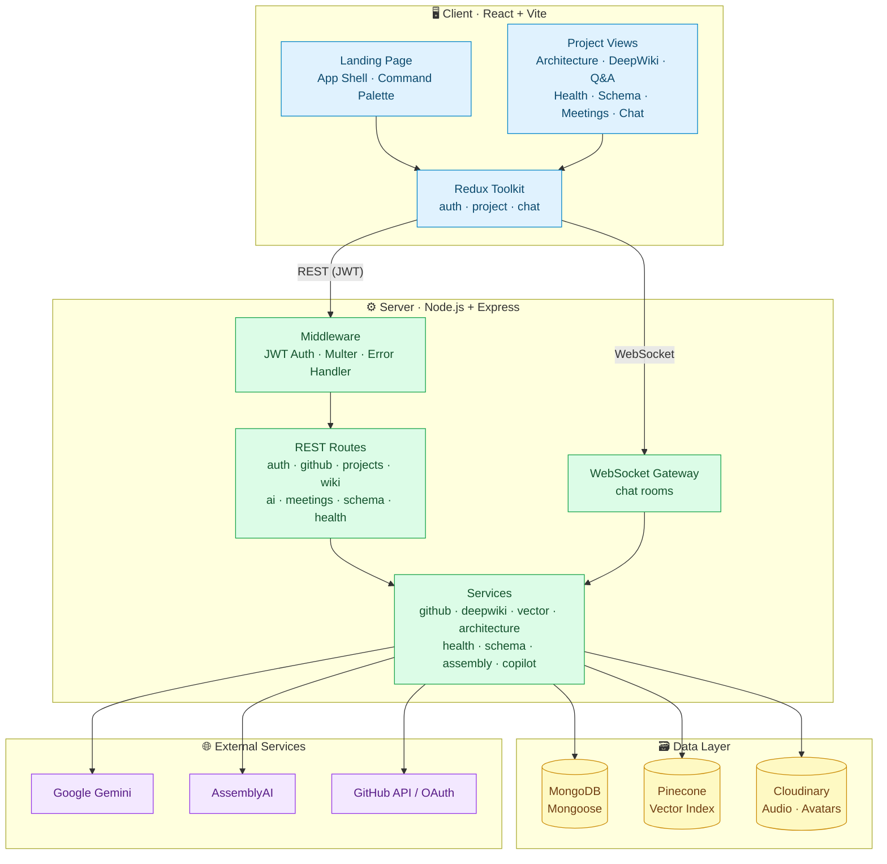
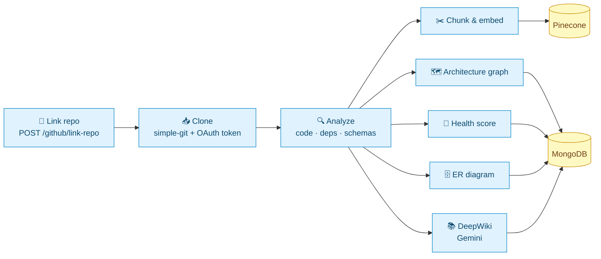
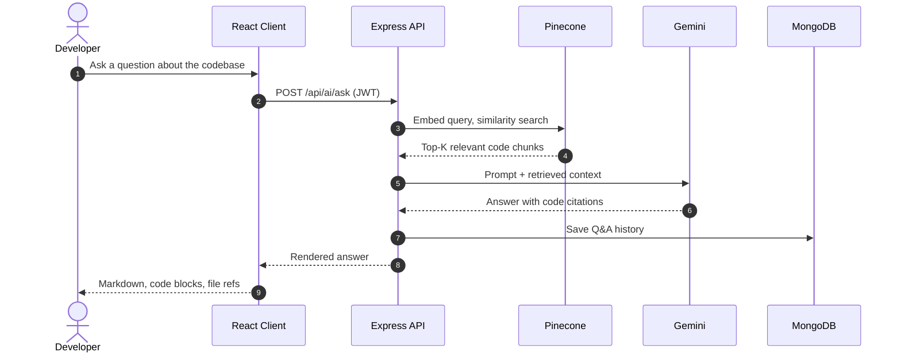
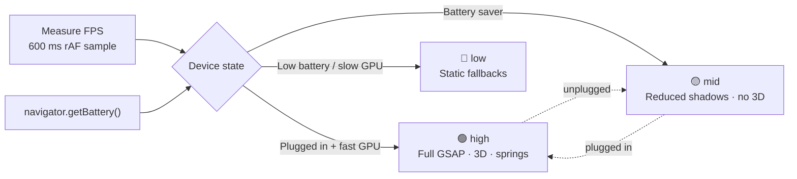

<div align="center">

# 🍷 Dionysus

### AI Codebase Intelligence & Collaboration Platform

*Turn source code and team meetings into interactive architecture maps, auto-generated wikis, semantic Q&A, and real-time collaborative intelligence.*

[](https://nodejs.org)
[](https://react.dev)
[](https://mongodb.com)
[](https://pinecone.io)
[](https://deepmind.google/technologies/gemini)
[](LICENSE)

[Features](#-features) · [Architecture](#-architecture) · [Getting Started](#-getting-started) · [API Reference](#-api-reference) · [Contributing](#-contributing)

</div>

---

## 📖 Table of Contents

- [Overview](#-overview)
- [Features](#-features)
- [Architecture](#-architecture)
- [Tech Stack](#-tech-stack)
- [Project Structure](#-project-structure)
- [Getting Started](#-getting-started)
  - [Prerequisites](#prerequisites)
  - [Installation](#installation)
  - [Environment Variables](#environment-variables)
  - [GitHub OAuth Setup](#github-oauth-setup)
  - [Running Locally](#running-locally)
- [API Reference](#-api-reference)
- [Performance & Battery Optimization](#-performance--battery-optimization)
- [Contributing](#-contributing)
- [License](#-license)
- [Authors](#-authors)

---

## 🚀 Overview

**Dionysus** is a full-stack, AI-powered developer intelligence platform that removes the friction of onboarding, documentation, and architectural understanding in large codebases.

Connect any public or private GitHub repository and Dionysus will automatically:

| Capability | What you get |
|---|---|
| 🗺️ **Architecture mapping** | Interactive layered map with blast-radius tracing |
| 📚 **DeepWiki** | A 5-chapter technical wiki generated from your code |
| 💬 **Semantic Q&A** | RAG-powered answers with code citations (Pinecone + Gemini) |
| 🎙️ **Meeting intelligence** | Transcription and AI-extracted engineering action items |
| 🗄️ **Schema visualization** | Auto-detected ER diagrams from Mongoose / Prisma |
| 🏥 **Health scoring** | 0–100 repository score with actionable fixes |
| 👥 **Team chat** | Real-time rooms with an embedded `@dionysus` AI co-pilot |

> Built for engineering teams who value velocity, clarity, and deep codebase understanding, without hand-writing documentation.

---

## ✨ Features

<details open>
<summary><b>🗺️ 1. Interactive Architecture & Dependency Graph</b></summary>

- **Subsystem boundary mapping**: presentation, API gateway, controllers, services, persistence, and external AI integrations shown as layered clusters
- **Annotated connectors**: curved dotted data-flow lines with protocol/correlation badges (`HTTP`, `SQL`, `+0.998`, `-0.644 Cycle!`)
- **Blast radius mode**: click a component to highlight upstream callers (sky blue) and downstream dependents (emerald); unrelated nodes dim
- **Blueprint canvas**: theme-aware dot grid with smooth wheel zoom
- **File-level dependency graph**: Cytoscape.js with force-directed layout

</details>

<details>
<summary><b>🤖 2. AI-Powered DeepWiki</b></summary>

- Generates a **5-chapter wiki**: Project Overview, Architecture, Key Modules, Data Flow, API Reference
- Rendered as Markdown with an interactive chapter navigator
- Polling-based incremental regeneration as the codebase evolves

</details>

<details>
<summary><b>💬 3. Semantic Codebase Q&A (RAG)</b></summary>

- **Pinecone embeddings**: code is chunked, embedded, and stored for accurate retrieval
- **Google Gemini**: code citations, architecture explanations, function-level reasoning
- **Rich rendering**: syntax-highlighted code, file references, Markdown
- **Per-project conversation history**

</details>

<details>
<summary><b>🎙️ 4. Meeting Transcription & Audio Intelligence</b></summary>

- **AssemblyAI speech-to-text**: MP3/WAV upload with multi-speaker recognition and timestamps
- **Action item extraction**: discussions become prioritized engineering tasks
- **Meeting archive**: browse and search past transcripts per project

</details>

<details>
<summary><b>🏥 5. Repository Health Scorecard</b></summary>

- **Score from 0–100** (grades A+ to F) covering coupling, complexity, dead code, and setup readiness
- **Radar chart**: Maintainability, Complexity, Documentation, Test Coverage, Security
- **Quick-fix cards** pointing to specific files and line ranges

</details>

<details>
<summary><b>🗄️ 6. Database Schema Intelligence</b></summary>

- **Automatic Mongoose & Prisma parsing** with zero configuration
- **Interactive ER diagram** with field types, relationships, and cardinality
- **Missing-index warnings** for high-query collections

</details>

<details>
<summary><b>👥 7. Real-Time Team Chat with AI Co-Pilot</b></summary>

- **WebSocket rooms**: one per repository
- **`@dionysus` agent**: mention it for in-thread code citations and architecture answers
- **`#file` mentions** with inline previews
- **Persistent, paginated history**

</details>

<details>
<summary><b>🔐 8. GitHub OAuth & Repository Integration</b></summary>

- **OAuth 2.0** with scopes `read:user`, `user:email`, `repo`
- **Private repo support**: cloned using the user's access token
- **1-click repo picker** with Public/Private filter and instant search
- **Account linking**: connect or disconnect GitHub anytime from Settings

</details>

<details>
<summary><b>⚙️ 9. User Settings</b></summary>

- **Profile**: display name, email, avatar with live preview
- **GitHub**: connection status, linked username and avatar
- **Security**: set or change password with strength indicator (supports GitHub-only accounts)

</details>

<details>
<summary><b>🎨 10. Battery-Aware Animated Landing Page</b></summary>

- **3-tier performance system** (`high` / `mid` / `low`) based on GPU performance
- **Battery API integration**: reduces animation load on battery, restores when plugged in
- **Lenis smooth scroll** with tier-aware lerp values
- **GSAP + Framer Motion**: scroll-triggered animation, 3D hero, parallax

</details>

---

## 🏗️ Architecture

### System Overview



### Repository Ingestion Pipeline



### Semantic Q&A (RAG) Flow



---

## 🛠️ Tech Stack

<table>
<tr>
<td valign="top" width="50%">

**Frontend**

| Technology | Purpose |
|---|---|
| [React 18](https://react.dev) | UI framework |
| [Vite 5](https://vitejs.dev) | Build tool & dev server |
| [Redux Toolkit 2](https://redux-toolkit.js.org) | State management |
| [React Router 6](https://reactrouter.com) | Routing |
| [Tailwind CSS 3](https://tailwindcss.com) | Styling |
| [shadcn/ui](https://ui.shadcn.com) | UI components |
| [GSAP 3](https://gsap.com) / [Framer Motion 11](https://www.framer.com/motion) | Animation |
| [Lenis](https://lenis.darkroom.engineering) | Smooth scroll |
| [Cytoscape.js 3](https://cytoscape.org) | Dependency graph |
| [React Flow 11](https://reactflow.dev) | Architecture canvas |
| [Mermaid 11](https://mermaid.js.org) | Diagram rendering |
| [Monaco Editor](https://microsoft.github.io/monaco-editor) | Code viewer |

</td>
<td valign="top" width="50%">

**Backend**

| Technology | Purpose |
|---|---|
| [Node.js 18+](https://nodejs.org) | Runtime |
| [Express 4](https://expressjs.com) | HTTP server |
| [MongoDB 7](https://mongodb.com) + [Mongoose 8](https://mongoosejs.com) | Database & ODM |
| [JWT](https://jwt.io) + [bcryptjs](https://github.com/dcodeIO/bcrypt.js) | Auth & hashing |
| [simple-git](https://github.com/steveukx/git-js) | Git operations |
| [ws](https://github.com/websockets/ws) | WebSocket server |
| [Multer](https://github.com/expressjs/multer) | File uploads |
| [Axios](https://axios-http.com) | HTTP client |
| [Octokit](https://github.com/octokit/octokit.js) | GitHub API client |

</td>
</tr>
</table>

**AI & Cloud Services**

| Service | Purpose |
|---|---|
| [Google Gemini](https://deepmind.google/technologies/gemini) | Q&A, wiki generation, action-item extraction |
| [Pinecone](https://pinecone.io) | Vector database for semantic search |
| [AssemblyAI](https://assemblyai.com) | Speech-to-text with speaker diarization |
| [Cloudinary](https://cloudinary.com) | Audio and avatar storage |
| [GitHub OAuth 2.0 / REST API](https://docs.github.com/en/apps/oauth-apps) | Auth, repo metadata, file tree, commits |

---

## 📁 Project Structure

```
dionysus-rebuild/
├── client/                              # React frontend (Vite)
│   └── src/
│       ├── components/
│       │   ├── layout/AppShell.jsx      # App shell & navigation
│       │   ├── motion/                  # SmoothScroll, usePerfTier
│       │   ├── project/                 # GithubRepoPickerModal
│       │   └── ui/                      # shadcn/ui components
│       ├── pages/
│       │   ├── landing/                 # Landing page, Hero3D, theme, hooks
│       │   ├── Login.jsx · Register.jsx · AuthCallback.jsx
│       │   ├── UserSettings.jsx         # 3-tab settings
│       │   ├── ProjectHome.jsx          # Project dashboard
│       │   ├── ArchitectureMap.jsx      # Architecture canvas
│       │   ├── DependencyGraph.jsx      # File-level graph
│       │   ├── DeepWiki.jsx             # Wiki viewer
│       │   ├── QnA.jsx                  # Semantic Q&A
│       │   ├── ProjectHealth.jsx        # Health scorecard
│       │   ├── DatabaseSchemaView.jsx   # ER diagram
│       │   ├── Meetings.jsx · MeetingDetail.jsx
│       │   ├── ChatRoom.jsx             # Real-time chat
│       │   └── FileVisualisation.jsx    # File browser
│       ├── store/slices/                # authSlice, projectSlice, chatSlice
│       ├── App.jsx                      # Routes
│       └── main.jsx                     # Entry point
│
├── server/                              # Node.js / Express backend
│   └── src/
│       ├── config/                      # db, cloudinary, env validation
│       ├── controllers/                 # auth, github, project, ai, wiki,
│       │                                # meeting, health, schema, chat, visualization
│       ├── middleware/                  # auth (JWT), upload (Multer), errorHandler
│       ├── models/                      # User, Project, WikiPage, Meeting,
│       │                                # ChatMessage, Commit, Issue, Question
│       ├── routes/                      # /api/auth, github, projects, ai, wiki,
│       │                                # meetings, health, schema, chat
│       ├── services/                    # github, deepwiki, vector, architecture,
│       │                                # dependency-graph, health-calculator,
│       │                                # schema-analyzer, assembly, copilot,
│       │                                # code-analyzer, graph-validator, openai
│       ├── websocket/chat.gateway.js    # WebSocket server & room manager
│       └── index.js                     # Express + WS entry point
│
├── optimize_projects.js                 # Utility: batch project optimization
├── ROADMAP.md
└── README.md
```

---

## 🚦 Getting Started

### Prerequisites

| Requirement | Version | Notes |
|---|---|---|
| [Node.js](https://nodejs.org) | 18.x LTS+ | Manage with `nvm` or `fnm` |
| [npm](https://npmjs.com) | 9.x+ | Bundled with Node.js |
| [Git](https://git-scm.com) | 2.x+ | Required for cloning repositories |
| [MongoDB](https://mongodb.com) | 7.x | Local install or [Atlas](https://cloud.mongodb.com) free tier |

You will also need accounts and API keys for:

- 🔑 [Google Gemini](https://aistudio.google.com): Q&A and wiki generation
- 🔑 [Pinecone](https://pinecone.io): vector database (free Starter tier works)
- 🔑 [AssemblyAI](https://assemblyai.com): meeting transcription
- 🔑 [Cloudinary](https://cloudinary.com): audio and image storage
- 🔑 [GitHub OAuth App](https://github.com/settings/developers): GitHub login and repo access

### Installation

```bash
# 1. Clone
git clone https://github.com/your-org/dionysus-rebuild.git
cd dionysus-rebuild

# 2. Install backend dependencies
cd server && npm install

# 3. Install frontend dependencies
cd ../client && npm install

# 4. Configure environment
cd ../server
cp .env.example .env     # then fill in your keys
```

### Environment Variables

Create `server/.env`:

```env
# ── Server ────────────────────────────────────────────
PORT=5000
NODE_ENV=development

# ── Database ──────────────────────────────────────────
MONGODB_URI=mongodb://localhost:27017/dionysus
# Atlas: mongodb+srv://<user>:<password>@cluster.mongodb.net/dionysus

# ── Authentication ────────────────────────────────────
JWT_SECRET=your_super_secret_jwt_key_at_least_32_characters_long

# ── Google Gemini ─────────────────────────────────────
GEMINI_API_KEY=your_gemini_api_key

# ── GitHub ────────────────────────────────────────────
GITHUB_PERSONAL_ACCESS_TOKEN=ghp_your_personal_access_token
GITHUB_CLIENT_ID=your_github_oauth_app_client_id
GITHUB_CLIENT_SECRET=your_github_oauth_app_client_secret
GITHUB_CALLBACK_URL=http://localhost:5000/api/auth/github/callback
CLIENT_URL=http://localhost:5173

# ── Pinecone ──────────────────────────────────────────
PINECONE_API_KEY=your_pinecone_api_key
PINECONE_INDEX=dionysus

# ── AssemblyAI ────────────────────────────────────────
ASSEMBLYAI_API_KEY=your_assemblyai_api_key

# ── Cloudinary ────────────────────────────────────────
CLOUDINARY_CLOUD_NAME=your_cloud_name
CLOUDINARY_API_KEY=your_cloudinary_api_key
CLOUDINARY_API_SECRET=your_cloudinary_api_secret
```

<details>
<summary><b>Variable reference (all required)</b></summary>

| Variable | Description |
|---|---|
| `PORT` | Port the Express server listens on |
| `MONGODB_URI` | MongoDB connection string (local or Atlas) |
| `JWT_SECRET` | Secret for signing JWTs; keep it private and long |
| `GEMINI_API_KEY` | Gemini key for Q&A, wiki, and co-pilot |
| `GITHUB_PERSONAL_ACCESS_TOKEN` | Fallback PAT for cloning public repos without OAuth |
| `GITHUB_CLIENT_ID` / `GITHUB_CLIENT_SECRET` | GitHub OAuth App credentials |
| `GITHUB_CALLBACK_URL` | Must exactly match the callback URL registered in GitHub |
| `CLIENT_URL` | Frontend URL, used for CORS and post-OAuth redirects |
| `PINECONE_API_KEY` / `PINECONE_INDEX` | Pinecone key and index name (create one named `dionysus`) |
| `ASSEMBLYAI_API_KEY` | AssemblyAI key for transcription |
| `CLOUDINARY_CLOUD_NAME` / `_API_KEY` / `_API_SECRET` | Cloudinary credentials |

</details>

### GitHub OAuth Setup

1. Open **GitHub → Settings → Developer Settings → [OAuth Apps](https://github.com/settings/developers)** and click **New OAuth App**.
2. Fill in the form:

   | Field | Value |
   |---|---|
   | Application name | `Dionysus (Local Dev)` |
   | Homepage URL | `http://localhost:5173` |
   | Authorization callback URL | `http://localhost:5000/api/auth/github/callback` |

3. Click **Register application**, then copy the **Client ID** and **Client Secret** into `server/.env`.

Requested scopes:

- `read:user`: read profile information
- `user:email`: read the user's email address
- `repo`: access public and **private** repositories (needed for private cloning)

> [!IMPORTANT]
> The callback URL in GitHub must exactly match `GITHUB_CALLBACK_URL`, including protocol and port. A mismatch will break OAuth.

> [!NOTE]
> For production, register a **separate** OAuth App with your production domain and update `GITHUB_CALLBACK_URL` and `CLIENT_URL`.

### Running Locally

```bash
# Terminal 1: backend (REST + WebSocket on :5000)
cd server
npm run dev

# Terminal 2: frontend (:5173)
cd client
npm run dev
```

**Production build**

```bash
cd client && npm run build
cd ../server && npm start
```

---

## 📡 API Reference

All endpoints are prefixed with the server base URL. 🔒 = requires `Authorization: Bearer <jwt>`.

<details open>
<summary><b>Authentication · <code>/api/auth</code></b></summary>

| Method | Endpoint | Auth | Description |
|---|---|:---:|---|
| `POST` | `/api/auth/register` | | Register with name, email, password |
| `POST` | `/api/auth/login` | | Log in and receive a JWT |
| `GET` | `/api/auth/me` | 🔒 | Current user profile |
| `PUT` | `/api/auth/profile` | 🔒 | Update name, email, or avatar |
| `PUT` | `/api/auth/password` | 🔒 | Change password (requires `currentPassword`) |
| `GET` | `/api/auth/github` | | Start GitHub OAuth flow |
| `GET` | `/api/auth/github/callback` | | GitHub OAuth callback |
| `DELETE` | `/api/auth/github` | 🔒 | Unlink GitHub account |

</details>

<details>
<summary><b>GitHub · <code>/api/github</code></b></summary>

| Method | Endpoint | Auth | Description |
|---|---|:---:|---|
| `POST` | `/api/github/link-repo` | 🔒 | Link a repo to a project (triggers clone + indexing) |
| `GET` | `/api/github/user-repos` | 🔒 | List repos accessible to the GitHub user |
| `GET` | `/api/github/commits/:projectId` | 🔒 | Latest commits for a project |

</details>

<details>
<summary><b>Projects & Visualization · <code>/api/projects</code></b></summary>

| Method | Endpoint | Auth | Description |
|---|---|:---:|---|
| `GET` | `/api/projects` | 🔒 | List the user's projects |
| `POST` | `/api/projects` | 🔒 | Create a project |
| `GET` | `/api/projects/:id` | 🔒 | Project details |
| `PUT` | `/api/projects/:id` | 🔒 | Update project metadata |
| `DELETE` | `/api/projects/:id` | 🔒 | Delete project and associated data |
| `GET` | `/api/projects/:id/architecture` | 🔒 | Architecture graph data |
| `GET` | `/api/projects/:id/dependency-graph` | 🔒 | File dependency graph |
| `GET` | `/api/projects/:id/file-tree` | 🔒 | Repository file tree |
| `GET` | `/api/projects/:id/file` | 🔒 | Read a file from the repository |

</details>

<details>
<summary><b>AI, Q&A & DeepWiki · <code>/api/ai</code> · <code>/api/wiki</code></b></summary>

| Method | Endpoint | Auth | Description |
|---|---|:---:|---|
| `POST` | `/api/ai/embed/:projectId` | 🔒 | Embed repository code into Pinecone |
| `POST` | `/api/ai/ask` | 🔒 | Ask a codebase question (RAG) |
| `GET` | `/api/ai/questions/:projectId` | 🔒 | Q&A history |
| `POST` | `/api/wiki/generate/:projectId` | 🔒 | Generate or regenerate the DeepWiki |
| `GET` | `/api/wiki/:projectId` | 🔒 | Fetch the wiki |
| `GET` | `/api/wiki/:projectId/chapter/:index` | 🔒 | Fetch one chapter |

</details>

<details>
<summary><b>Health, Schema & Meetings</b></summary>

| Method | Endpoint | Auth | Description |
|---|---|:---:|---|
| `GET` | `/api/health/:projectId` | 🔒 | Compute health scorecard (0–100) |
| `GET` | `/api/schema/:projectId` | 🔒 | Parse and return ER diagram data |
| `GET` | `/api/meetings/:projectId` | 🔒 | List meetings for a project |
| `POST` | `/api/meetings` | 🔒 | Upload audio and start transcription |
| `GET` | `/api/meetings/:id` | 🔒 | Transcript and action items |
| `DELETE` | `/api/meetings/:id` | 🔒 | Delete a meeting |

</details>

<details>
<summary><b>Chat · <code>/api/chat</code> + WebSocket</b></summary>

| Method | Endpoint | Auth | Description |
|---|---|:---:|---|
| `GET` | `/api/chat/:projectId/messages` | 🔒 | Paginated chat history |
| `WS` | `ws://localhost:5000` | 🔒 | Real-time room (JWT sent in first message) |

**WebSocket handshake**

```jsonc
// 1. Authenticate
{ "type": "auth", "token": "<jwt>" }
// 2. Join a project room
{ "type": "join", "projectId": "<id>" }
```

</details>

---

## ⚡ Performance & Battery Optimization

The landing page uses a 3-tier performance system to keep animations smooth on any device.



| Mechanism | Behavior |
|---|---|
| `usePerfTier.js` | Samples FPS, reads battery status, sets `data-battery` / `data-perf` on `<html>` |
| Lenis smooth scroll | `lerp: 0.13` on `high`, `0.095` on `mid` |
| GSAP scrub | `scrubFor()` returns `0.2 / 0.7 / 0.5` per tier |
| 3D hero | Idle animation loop pauses on battery |
| CSS rules | `data-battery` applies `will-change: transform`, simplifies `box-shadow`, disables blur-heavy effects |

---

## 🤝 Contributing

Contributions are welcome!

1. **Fork** the repository
2. **Create a branch**: `git checkout -b feature/your-feature-name`
3. **Commit**: `git commit -m "feat: add your feature"`
4. **Push**: `git push origin feature/your-feature-name`
5. **Open a Pull Request** against `main`

**Commit convention**: [Conventional Commits](https://www.conventionalcommits.org/)

| Prefix | Use for |
|---|---|
| `feat:` | New feature |
| `fix:` | Bug fix |
| `docs:` | Documentation |
| `style:` | Formatting only |
| `refactor:` | Restructure without behavior change |
| `perf:` | Performance improvement |
| `chore:` | Build system, dependencies |

**Code style**

- **Frontend**: ESLint (Oxlint) + Prettier; run `npm run lint` before committing
- **Backend**: standard Node.js conventions; prefer `async/await` over callbacks
- **Components**: one per file; keep pages thin and logic in hooks/services

---

## 📄 License

Distributed under the **MIT License**. See [`LICENSE`](LICENSE) for details.

---

## 👥 Authors

<table>
  <tr>
    <td align="center"><b>Darshan Walher</b></td>
    <td align="center"><b>Fiza Shaikh</b></td>
    <td align="center"><b>Omkar Pande</b></td>
    <td align="center"><b>Tanaya Mote</b></td>
  </tr>
</table>

---

<div align="center">

*Built with ❤️ to give every developer superpowers over their codebase.*

**[⬆ Back to top](#-dionysus)**

</div>