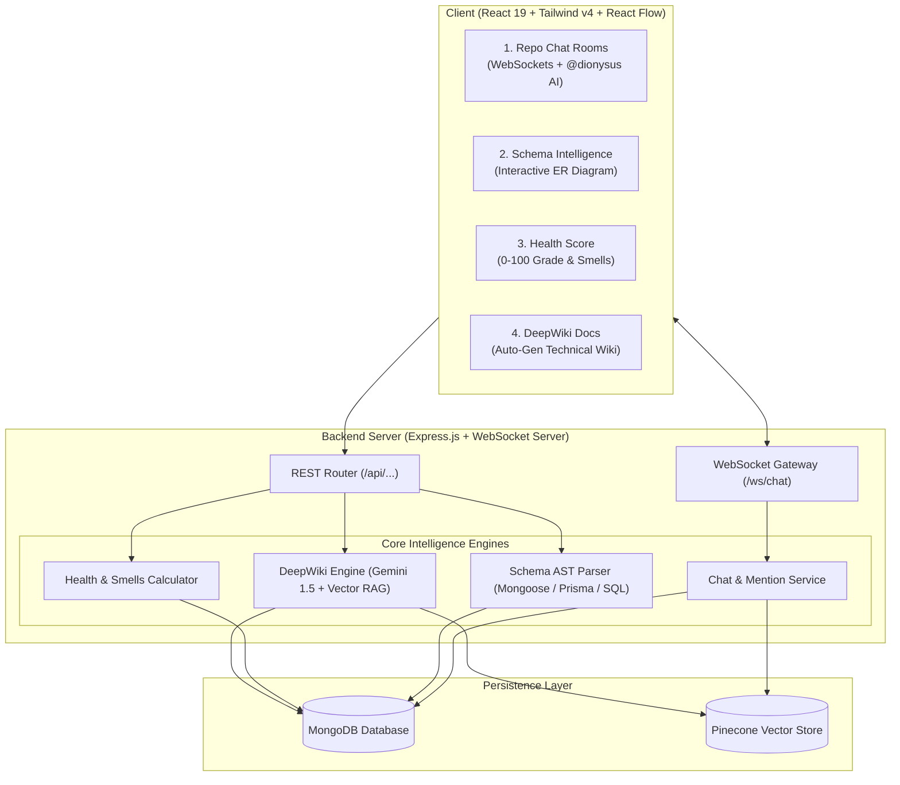
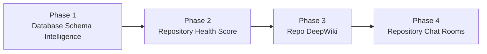

# Dionysus — Next-Gen Feature Implementation Roadmap

This roadmap outlines the technical architecture, data models, API endpoints, and frontend components for the four major intelligence features planned for Dionysus:

1. **Repository-Based Chat Rooms** (Real-Time Team + AI Co-pilot Chat)
2. **Database Schema Intelligence** (Entity-Relationship Diagram & Index Analyzer)
3. **Repository Health Score** (0–100 Architectural Quality & Tech Debt Scorecard)
4. **Repo DeepWiki** (Multi-Chapter Automated Technical Wiki & Documentation Engine)

---

## Architecture Overview



---

## Feature 1: Repository-Based Chat Rooms

### 1.1 Objective
Provide team collaboration channels scoped directly to each repository project. Developers can discuss implementations, share syntax-highlighted code snippets, and summon an embedded AI agent (`@dionysus`) to query repository architecture, code symbols, and meeting transcripts directly in the thread.

### 1.2 User Experience & Interactions
* **Live Chat Stream**: Real-time communication via WebSockets.
* **`@dionysus` Mention**: Asking `@dionysus how does auth session expiration work?` triggers the AI to query Pinecone vector embeddings and stream the response with code citations.
* **File & Symbol Autocomplete**: Typing `#` opens a dropdown of repository files (e.g., `#server/src/models/User.js`) which generates an interactive chip linking to the file visualizer.
* **Threaded Replies**: Reply to specific messages to keep architectural discussions organized.

### 1.3 Database Schema (`server/src/models/ChatMessage.js`)
```javascript
const mongoose = require('mongoose');

const chatMessageSchema = new mongoose.Schema(
  {
    project: {
      type: mongoose.Schema.Types.ObjectId,
      ref: 'Project',
      required: true,
      index: true,
    },
    sender: {
      type: {
        type: String,
        enum: ['user', 'ai'],
        default: 'user',
      },
      user: {
        type: mongoose.Schema.Types.ObjectId,
        ref: 'User',
      },
      name: { type: String, required: true },
      avatar: { type: String, default: '' },
    },
    content: {
      type: String,
      required: true,
      trim: true,
    },
    taggedFiles: [{ type: String }],
    replyTo: {
      type: mongoose.Schema.Types.ObjectId,
      ref: 'ChatMessage',
      default: null,
    },
    reactions: [
      {
        user: { type: mongoose.Schema.Types.ObjectId, ref: 'User' },
        emoji: String,
      },
    ],
  },
  { timestamps: true }
);

module.exports = mongoose.model('ChatMessage', chatMessageSchema);
```

### 1.4 API & WebSocket Specifications
* `WS /ws/chat?projectId=<ID>&token=<JWT>` – Join real-time project room.
* `GET /api/projects/:id/chat/messages?page=1&limit=50` – Retrieve paginated chat history.
* `POST /api/projects/:id/chat/messages` – REST fallback for sending messages.

---

## Feature 2: Database Schema Intelligence

### 1.1 Objective
Automatically parse database models and generate an interactive **Entity-Relationship (ER) diagram** on the canvas, showing tables/collections, field data types, validations, foreign key connections, and performance/indexing warnings.

### 1.2 Key Capabilities
* **Automatic Model Detection**: Parses Mongoose schemas, Prisma schema definitions, and SQL migrations.
* **Field Visualizer**: Displays Primary Keys (`PK`), Foreign Keys (`FK`), Indexes (`IDX`), and data types (`ObjectId`, `String`, `Date`).
* **Visual Cardinality**: Arrows representing `1:1`, `1:N`, and `M:N` relations connecting entity cards.
* **Schema Health Diagnostics**: Flags missing indexes on foreign keys, unindexed unique fields, and unbounded nested arrays.

### 1.3 Schema Structure (`Project.schemaIntelligence`)
```json
{
  "entities": [
    {
      "id": "User",
      "name": "User",
      "collection": "users",
      "fields": [
        { "name": "_id", "type": "ObjectId", "isPrimary": true },
        { "name": "email", "type": "String", "required": true, "unique": true, "isIndexed": true },
        { "name": "password", "type": "String", "select": false }
      ],
      "relations": [
        { "target": "Project", "type": "1:N", "foreignKey": "owner" }
      ],
      "diagnostics": []
    },
    {
      "id": "Project",
      "name": "Project",
      "collection": "projects",
      "fields": [
        { "name": "_id", "type": "ObjectId", "isPrimary": true },
        { "name": "name", "type": "String", "required": true },
        { "name": "owner", "type": "ObjectId", "isForeignKey": true, "ref": "User" }
      ],
      "relations": [
        { "target": "User", "type": "N:1", "foreignKey": "owner" }
      ],
      "diagnostics": [
        { "severity": "warning", "message": "Field 'owner' is frequently queried but lacks a compound index." }
      ]
    }
  ]
}
```

### 1.4 Frontend Integration
* Custom React Flow node: `TableEntityNode.jsx` rendering database fields with type badges.
* Integrated as a dedicated tab (`"Database ER"`) inside `FileVisualisation.jsx`.

---

## Feature 3: Repository Health Score & Smells

### 1.1 Objective
Compute an objective, actionable **0–100 Repository Health Score** (graded `A+` through `F`) evaluating architecture, code complexity, maintenance risks, and onboarding readiness.

### 1.2 Metric Weight Distribution

| Category | Weight | Evaluation Criteria |
|---|---|---|
| **Architecture & Coupling** | 30% | Number of circular dependency loops, modular layering, cross-tier leakage. |
| **Code Complexity & Size** | 25% | Presence of oversized "God files" (>600 LOC), fan-out degree, excessive nesting. |
| **Dead Code & Hygiene** | 15% | Isolated files with 0 incoming callers and 0 external usages. |
| **Documentation & Onboarding** | 15% | Presence of `.env.example`, README, inline JSDoc, API contracts. |
| **Dependencies & Security** | 15% | Outdated npm packages, missing lockfiles, exposed secret patterns. |

### 1.3 Diagnostic Output Example (`/api/projects/:id/health`)
```json
{
  "score": 92,
  "grade": "A",
  "breakdown": {
    "architecture": { "score": 95, "max": 100, "status": "Excellent" },
    "complexity": { "score": 85, "max": 100, "status": "Good" },
    "deadCode": { "score": 90, "max": 100, "status": "Low waste" },
    "onboarding": { "score": 100, "max": 100, "status": "Complete" },
    "security": { "score": 90, "max": 100, "status": "Healthy" }
  },
  "actionableQuickFixes": [
    {
      "id": "fix_cycle_1",
      "severity": "high",
      "title": "Resolve Circular Dependency",
      "description": "auth.controller.js and user.service.js form an import cycle.",
      "scoreImpact": "+4 points",
      "file": "server/src/controllers/auth.controller.js"
    }
  ]
}
```

### 1.4 Frontend Deliverable
* `client/src/pages/ProjectHealth.jsx` dashboard displaying:
  * Radial progress gauge with grade badge (`A+`, `A`, `B`, `C`, `F`).
  * Category breakdown progress bars.
  * 1-click **"Quick Fix Action Items"** that navigate directly to problem files in the graph.

---

## Feature 4: Repo DeepWiki-Like Documentation

### 1.1 Objective
Upgrade static documentation into a dynamic, AI-synthesized **DeepWiki** (inspired by Devv and DeepSeek Docs) that indexes the repository into organized technical chapters with interactive diagrams, API dictionaries, and search.

### 1.2 DeepWiki Chapter Structure

```
📖 DEEPWIKI CHAPTERS
├── 1. Overview & High-Level Architecture
│   ├── System Boundaries & Microservices
│   ├── Interactive Ingress Data Flow (with Mermaid)
├── 2. API Endpoints & Routes Reference
│   ├── Authentication & Session APIs
│   ├── Project & Visualizer Endpoints
│   ├── Request/Response Payload Dictionaries
├── 3. Database & Entity Dictionary
│   ├── Collections, Fields, and Validations
│   ├── Indexing Strategies & Relations
├── 4. Environment & Deployment Setup
│   ├── Comprehensive .env Variable Guide
│   ├── Local Setup, Docker, and Startup Diagnostics
└── 5. Security & Middleware Lifecycles
    ├── JWT Protection & Rate Limiting
    ├── CORS, Helmet & Security Headers
```

### 1.3 Database Schema (`server/src/models/WikiPage.js`)
```javascript
const mongoose = require('mongoose');

const wikiPageSchema = new mongoose.Schema(
  {
    project: {
      type: mongoose.Schema.Types.ObjectId,
      ref: 'Project',
      required: true,
      index: true,
    },
    slug: { type: String, required: true },
    title: { type: String, required: true },
    category: { type: String, required: true },
    order: { type: Number, default: 0 },
    markdownContent: { type: String, required: true },
    referencedFiles: [{ type: String }],
    isGenerated: { type: Boolean, default: true },
    lastGeneratedAt: { type: Date, default: Date.now },
  },
  { timestamps: true }
);

wikiPageSchema.index({ project: 1, slug: 1 }, { unique: true });

module.exports = mongoose.model('WikiPage', wikiPageSchema);
```

### 1.4 Frontend UI
* **Two-Column Reader Layout**: Left sticky table of contents; right high-contrast markdown viewer.
* **Inline Mermaid Diagrams**: Interactive diagrams rendered directly within documentation prose.
* **Cross-Linking**: Clicking a referenced model or route opens its definition drawer in the architecture visualizer.
* **Export Engine**: 1-click export to Markdown book or PDF.

---

## Phased Implementation Plan



### Milestone Checklist

- [ ] **Phase 1: Database Schema Intelligence**
  - [ ] Implement `schema-analyzer.service.js` to parse Mongoose models.
  - [ ] Create `TableEntityNode.jsx` for React Flow ER diagram rendering.
  - [ ] Add `"Database ER"` view tab to `FileVisualisation.jsx`.
- [ ] **Phase 2: Repository Health Score**
  - [ ] Implement `health-calculator.service.js` algorithm.
  - [ ] Build `ProjectHealth.jsx` dashboard with metric progress rings and quick fixes.
  - [ ] Add Health score badge to navigation and project overview.
- [ ] **Phase 3: Repo DeepWiki**
  - [ ] Create `WikiPage.js` model and `deepwiki.service.js` synthesis engine.
  - [ ] Build multi-chapter tree reader in `client/src/pages/DeepWiki.jsx`.
  - [ ] Add 1-click "Regenerate Wiki with AI" action.
- [ ] **Phase 4: Repository Chat Rooms**
  - [ ] Create `ChatMessage.js` model and WebSocket server in `server/src/index.js`.
  - [ ] Build `ProjectChat.jsx` with real-time streaming and `@dionysus` summon logic.
  - [ ] Add `#` file autocompletion and code snippet formatting.

